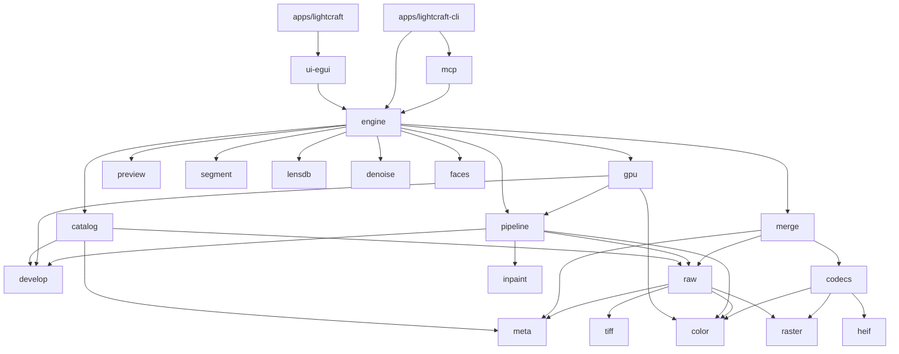

# Code map (our fork)

The code is upstream's Cargo workspace. Upstream's committed architecture summary is `docs/architecture.md` (layers L0-L6, enforced by `cargo xtask layers` inside `cargo xtask ci`); read it first. This map adds how the modules connect and what differs per platform (R04). Audited 2026-10-28 against `main`: the 29 library crates, 3 apps and `xtask` are the whole workspace (`crates/*`, `apps/*`, `xtask`), and every crate sits in the row and layer that its `Cargo.toml` description names.

Describes commit: e1e51488 (2026-10-28)

## Modules

| Path | Crate | Layer | Owns | Platform notes |
|---|---|---|---|---|
| `crates/geom`, `color`, `raster`, `tiff` | lightcraft-* | L0 | Matrices and warps, colour spaces, float image buffers, TIFF/IFD | pure, all |
| `crates/fetch` | lightcraft-fetch | L0 | Pinned HTTPS model downloads | all |
| `crates/sysmem` | lightcraft-sysmem | L0 | Returns freed allocator memory to the OS; the only `unsafe` crate | per OS (`malloc_zone_pressure_relief` on macOS) |
| `crates/raw` | lightcraft-raw | L1 | Raw decoders per maker (`src/vendor/*.rs`: orf, nef, arw, cr3, ...), demosaic, DNG colour model | pure, all |
| `crates/codecs`, `heif` | lightcraft-codecs, -heif | L1 | Standard codecs, ICC, encoders; optional HEIC | pure, all |
| `crates/meta` | lightcraft-meta | L1 | EXIF, XMP, IPTC | pure, all |
| `crates/develop` | lightcraft-develop | L1 | The non-destructive edit model, control specs, presets | pure, all |
| `crates/denoise-core`, `denoise`, `faces`, `scenes`, `slideshow`, `inpaint`, `geocode` | lightcraft-* | L1 | AI denoise, face detection, demo scenes, slides, hole filling, offline geocoding | pure, all (CPU inference) |
| `crates/testkit` | lightcraft-testkit | dev-only | Test tooling: a test that cannot run here records why, so `cargo xtask ci` reports it | pure, all |
| `crates/lensdb` | lightcraft-lensdb | L2 | Lens profile models and lensfun-format loader | pure, all |
| `crates/pipeline` | lightcraft-pipeline | L2 | The develop pipeline, CPU reference | pure, all |
| `crates/catalog`, `preview`, `merge`, `segment` | lightcraft-* | L3 | Library and persistence, preview cache and job pool, HDR/panorama merge, SAM 3 segmentation | all |
| `crates/gpu` | lightcraft-gpu | L3 | wgpu compute twin of the pipeline | Metal (macOS), Vulkan (Linux), DX12/Vulkan (Windows); proven on Apple and one AMD GPU only |
| `crates/engine` | lightcraft-engine | L4 | Session, command registry, history, render/export jobs, import, Lightroom catalog import | all |
| `crates/ui-egui`, `mcp` | lightcraft-ui-egui, -mcp | L5 | The Lightroom-style UI; the MCP server | all; native menus and file dialogs differ per OS |
| `apps/lightcraft`, `lightcraft-cli`, `lightcraft-web` | | L6 | Desktop app, CLI, WASM build | packaging in `packaging/` per OS |

## How they connect

## Upstream and our delta

Every crate, app and the `xtask` here is upstream's (`storytold/lightcraft`). Our delta on top is documentation only: `PIPELINE.md`, `SPEC.md`, `CHANGELOG.md`, `AGENTS.fork.md`, this map, `docs/agents/`, and ten lines in `CLAUDE.md` (agent-skills config); `git diff --stat upstream/main...main` shows no source file. Upstream commits daily, so a day or two of its work is not on `main` until the daily sync merges it (on 2026-10-28 the crate set was identical on both).

## Outside the workspace

In this repo but outside the Cargo workspace: `tools/` (SAM 3 install scripts and the Python reference scripts for the `segment` crate and the camera table; not part of the build), `packaging/` (per-OS release packaging: `linux`, `macos`, `windows`, `freebsd`, `web`), `assets/` (app icons, fonts, camera profiles and tone data), `nix/` and `flake.nix`, `omastore.toml` (store listing data), `contributors/`.

Not here at all: shared code that comes in as git dependencies pinned by revision, so a change to it is a change in another repository: the `craft-*` crates (`craft-docpath`, `craft-ui`, `craft-update`, `craft-window` from `storytold/craft-libs`) and forks of egui, eframe and winit (`storytold/egui`, `storytold/winit`).

## Mac, PC and Linux

- CI: `ci.yml` (every pull request and push to main) calls the shared gate workflow in `storytold/craft-common-actions` with its default `os` input, `["ubuntu-24.04"]`, so `cargo xtask ci` runs on Linux x64 only. No workflow runs the tests on macOS or Windows (gap 9; our build issue #16 adds them). Other workflows: `freebsd.yml` (VM build, nightly and on release), `windows-arm64.yml` (cross-builds the ARM64 package and smoke-tests the install on a native ARM runner; no `cargo test`), `packaging-lint.yml` (static checks plus a `windows-latest` job that tests the MSI install-folder logic), `nix.yml` (flake evaluation), `sonarcloud.yml` and `release.yml`.
- Platform code sits behind `cfg(target_os)` in `sysmem`, `ui-egui` (menus, dialogs, settings) and `gpu` backends; a change there gets a `platform:*` label.
- Display profiles: macOS reads the screen's, Linux reads colord's, Windows has none yet (gap 22).
